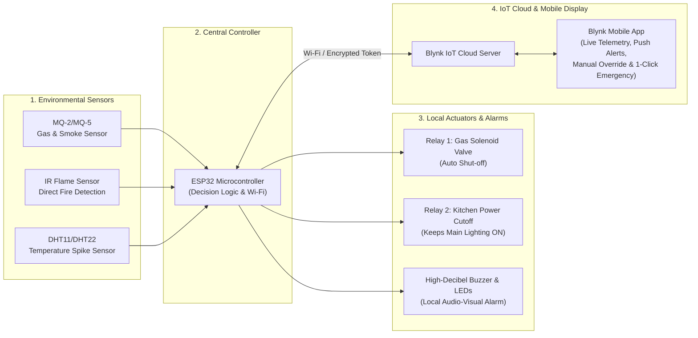

[Safety_Home_System_Readme.md](https://github.com/user-attachments/files/35040661/Safety_Home_System_Readme.md)
# 🏠 Safety Home System | Software Engineering & Architecture Documentation

[](#)
[](#)
[](#)
[](#)
[-orange)](#)

> **Safety Home** is a safety-critical IoT and Embedded Software System designed for homes and facilities to provide early detection and automated fail-safe response against combustible gas leaks, smoke, sudden temperature spikes, and direct flames.

🎓 **Academic Supervision:**
* **Course Instructor:** **Dr. Ahmed Yousry**
* **Teaching Assistant:** **Eng. Sohaila Amr**
* **Institution:** Faculty of Computers and Artificial Intelligence — Benha University (BFCAI) • *Third Year (Artificial Intelligence Department)*

🔗 **Quick Project Links:**
* 🌐 **Live Product Landing Page:** [Safety Home Web Portal](https://github.com/mooaz-ebrahiem/safety_home)
* 📸 **Official Instagram Page:** [@safety.home.eg](https://www.instagram.com/safety.home.eg/)
* 💻 **Documentation Repository:** [Software-Engineering-Architecture-Documentation](https://github.com/Mohamed-Tamer-Ai/Software-Engineering-Architecture-Documentation)

---

## 📑 Table of Contents
1. [Project Overview (نظرة عامة على المشروع)](#-1-project-overview-نظرة-عامة-على-المشروع)
2. [Key System Features (المميزات الرئيسية)](#-2-key-system-features-المميزات-الرئيسية)
3. [Hardware & Software Architecture (البنية المعمارية)](#-3-hardware--software-architecture-البنية-المعمارية)
4. [System Lifecycle & Emergency Workflow (سيناريو التشغيل)](#-4-system-lifecycle--emergency-workflow-سيناريو-التشغيل)
5. [Requirements Engineering (هندسة المتطلبات)](#-5-requirements-engineering-هندسة-المتطلبات)
6. [UML System Modeling & Scenarios (النمذجة الهندسية وفق سكاشن المادة)](#-6-uml-system-modeling--scenarios-النمذجة-الهندسية-وفق-سكاشن-المادة)
7. [Software Engineering Artifacts (هيكل المستودع)](#-7-software-engineering-artifacts-هيكل-المستودع)
8. [Course References & Section Drives (مصادر ودرايف سكاشن المادة)](#-8-course-references--section-drives-مصادر-ودرايف-سكاشن-المادة)
9. [Project Team — Team #5 (أعضاء الفريق)](#-9-project-team--team-5-أعضاء-الفريق)

---

## 📌 1. Project Overview (نظرة عامة على المشروع)

When embedded software directly controls physical hardware in a **Smart Home**, any defect can impact human safety, cost, and trust. Therefore, **Safety Home** is engineered using a **systematic, disciplined, and quantifiable** Software Engineering approach across all stages of the **Software Development Life Cycle (SDLC)**:

$$\text{Requirements Analysis} \rightarrow \text{Design} \rightarrow \text{Implementation} \rightarrow \text{Testing} \rightarrow \text{Maintenance}$$

**Safety Home** continuously monitors indoor environmental conditions in real time. Upon detecting a hazard (combustible gas leak, smoke, rapid thermal spike, or direct flame), it executes an immediate local fail-safe protocol—cutting off the mechanical gas valve and isolating kitchen electrical outlets to prevent sparks while **intentionally keeping primary room lighting active** for safe evacuation—and alerts the homeowner remotely via the **Blynk IoT Mobile App** with one-click access to emergency services.

---

## ✨ 2. Key System Features (المميزات الرئيسية)

* **🔥 Multi-Hazard Early Detection (المراقبة والإنذار المبكر المزدوج):**
  * **Gas & Smoke Monitoring:** Continuous sensing of LPG, methane, natural gas, and smoke using `MQ-2 / MQ-5` sensors.
  * **Direct Flame Detection:** Instant optical detection of fire outbreaks via an `IR Flame Sensor`.
  * **Thermal Spike Detection:** Monitoring rapid, abnormal increases in ambient temperature (via `DHT11 / DHT22` sensors) to trigger early warnings before fire spreads.
* **⚡ Smart & Safe Power Management (الفصل الذكي والآمن للكهرباء والغاز):**
  * Automatically disconnects kitchen appliances and power sockets via relays during a gas leak to eliminate electrical sparks.
  * **Evacuation Lighting Exception (استثناء الإضاءة):** Intentionally keeps the main room lighting circuit powered so residents can see and evacuate safely during emergencies.
  * Automatically closes the mechanical gas solenoid valve.
* **🔊 Dual Local Alerting (أنظمة إنذار محلية مزدوجة):**
  * Activates a high-decibel **Buzzer** and visual **LED** indicators immediately on-site.
* **📱 IoT Mobile Integration & Emergency Dispatch (التنبيه والتحكم الذكي عبر الموبايل):**
  * Real-time live sensor telemetry on the user's smartphone via **Blynk IoT**.
  * Instant **Push Notifications** when hazard thresholds are breached.
  * **Manual Override (التحكم اليدوي):** Remote control to shut off valves or reset the system after hazard clearance.
  * **One-Click Emergency Call (طلب الطوارئ الفوري):** Direct in-app shortcut to call Civil Defense (Fire Department / Ambulance).

---

## 🏗️ 3. Hardware & Software Architecture (البنية المعمارية)

Following the standard **Safety-Critical Embedded Architecture** ($\text{Sensor} \rightarrow \text{Controller} \rightarrow \text{Actuator / Alarm / Display}$):



### 🔧 Hardware Components (المكونات الهاردوير)
1. **Microcontroller:** `ESP32` board (Built-in Wi-Fi & Bluetooth) for sensor acquisition, local decision-making, and cloud communication.
2. **Sensors:**
   * `MQ-2 / MQ-5` Gas & Smoke Sensor.
   * `IR Flame Sensor` for direct fire detection.
   * `DHT11 / DHT22` Temperature Sensor for thermal spike detection.
3. **Actuators & Alarms:**
   * `Relay Module 1`: Controls the automated mechanical gas solenoid valve.
   * `Relay Module 2`: Isolates kitchen power sockets to prevent sparks while preserving the primary room lighting line.
   * `Buzzer & Status LEDs`: Local audio-visual warning system.
4. **Power Supply:** Regulated fail-safe power supply unit.

### 💻 Software & Modeling Stack (البرمجيات والمنصات)
* **Embedded Firmware:** C++ (Developed and compiled via Arduino IDE).
* **IoT Cloud & Mobile UI:** Blynk Cloud Server & Blynk Mobile Application.
* **Web Presence:** HTML/CSS/JS Product Landing Page hosted on GitHub Pages (`mooaz-ebrahiem/safety_home`).
* **UML & Design Tools:** [Draw.io (diagrams.net)](https://app.diagrams.net/) & [Wondershare EdrawMax UML](https://edraw.wondershare.com/edraw-uml.html).

---

## 🔄 4. System Lifecycle & Emergency Workflow (سيناريو التشغيل)

1. **Normal State (حالة الاستعداد):** The system monitors all sensors continuously and streams normal live telemetry to the Blynk mobile dashboard.
2. **Detection State (رصد الخطر):** A sensor detects gas concentration, smoke, direct flame, or a sudden temperature spike exceeding safe thresholds and signals the `ESP32`.
3. **Automated Action State (الاستجابة الفورية الآلية):**
   * Triggers the local `Buzzer` and warning `LEDs`.
   * Cuts off kitchen power outlets via `Relay 2` while **keeping primary lighting ON**.
   * Closes the main gas valve automatically via `Relay 1`.
   * Dispatches an urgent Push Notification via Wi-Fi to the `Blynk App`.
4. **Resolution & Emergency Escalation (التحكم والحل):** The homeowner reviews live readings on the mobile app, can press the **One-Click Emergency Call** button to contact the Fire Department/Ambulance, or perform a **Manual Override** once the hazard is resolved.

---

## 📋 5. Requirements Engineering (هندسة المتطلبات)

### 5.1 Functional Requirements (المتطلبات الوظيفية)
* **FR-01 (Multi-Sensor Polling):** The `ESP32` shall continuously sample gas/smoke concentration, flame presence, and ambient temperature.
* **FR-02 (Hazard Threshold Evaluation):** The system shall classify an emergency state immediately when any sensor reading exceeds predefined safety thresholds.
* **FR-03 (Automated Fail-Safe Isolation):** Upon hazard detection, the system shall trigger `Relay 1` to close the gas valve and `Relay 2` to cut kitchen appliance power while keeping the primary lighting circuit active.
* **FR-04 (Local Audio-Visual Alarm):** The system shall activate the on-site buzzer and warning LEDs immediately upon hazard detection.
* **FR-05 (Real-Time Cloud Telemetry & Push Alerts):** The system shall transmit live sensor data and instant emergency push notifications to the homeowner's Blynk mobile application.
* **FR-06 (Remote Manual Override & Emergency Call):** The mobile application shall allow authenticated users to remotely shut off/reset relays (when sensor readings are safe) and initiate a one-click call to emergency services.

### 5.2 Non-Functional Requirements (المتطلبات غير الوظيفية)
*Non-Functional Requirements (NFRs) specify **how well** the safety-critical system performs its functions:*

| ID | Requirement | Quantifiable Engineering Specification | الوصف الهندسي |
| :---: | :--- | :--- | :--- |
| **NFR-01** | **🛡️ Reliability** | The system shall operate continuously ($24/7$) without unexpected crashes during normal use and detect hazards accurately with minimal false alarms. | يعمل النظام باستمرار على مدار الساعة ويرصد المخاطر بدقة واعتمادية عالية دون توقف مفاجئ. |
| **NFR-02** | **⚡ Performance** | The system shall execute local hardware actions (buzzer & relay cutoffs) within $< 1\text{ second}$ of detection and deliver mobile push notifications within $< 3\text{ seconds}$. | الاستجابة اللحظية للخطر محلياً في أقل من ثانية واحدة، وإرسال إشعار الهاتف في أقل من $3$ ثوانٍ. |
| **NFR-03** | **🔒 Security** | Remote access and manual override controls via Blynk shall be protected using authenticated credentials and encrypted tokens against unauthorized users. | حماية الوصول عن بُعد والتحكم في المحابس ضد أي دخول غير مصرح به عبر جلسات مشفرة. |
| **NFR-04** | **📱 Usability** | The mobile application dashboard shall be simple and intuitive, allowing homeowners to view hazard status or trigger an emergency call in $\le 2\text{ taps}$. | واجهة تطبيق الموبايل بسيطة وسهلة الاستخدام تتيح قراءة الحساسات أو طلب الطوارئ بضغطة واحدة. |
| **NFR-05** | **🌐 Availability** | The local safety loop (sensors, ESP32, buzzer, and relays) shall remain $100\%$ operational offline even if Wi-Fi or internet connectivity is lost. | عمل الإنذار المحلي وفصل الغاز والكهرباء تلقائياً بكفاءة تامة حتى في حال انقطاع الإنترنت. |
| **NFR-06** | **🚨 Safety** | The system shall prevent unsafe operations during emergencies (cutting kitchen sparks while keeping evacuation lighting ON, and blocking valve re-opening until gas clears). | منع أي تشغيل غير آمن وقت الطوارئ (فصل كهرباء المطبخ مع إبقاء الإضاءة، ومنع فتح المحبس طالما الخطر قائماً). |
| **NFR-07** | **🔧 Maintainability** | Sensors (`MQ`, `Flame`, `DHT`) and modular firmware functions shall be designed for easy inspection, calibration, fault isolation, and hardware replacement. | سهولة فحص وصيانة ومعايرة واستبدال الحساسات ومكونات الهاردوير والكود. |
| **NFR-08** | **📈 Scalability** | The system architecture shall support integrating additional IoT sensor nodes, extra rooms, or smart actuators in the future without major redesign. | قابلية النظام للتوسع مستقبلاً وإضافة حساسات وغرف ومميزات أمان جديدة بسهولة. |

---

## 🧩 6. UML System Modeling & Scenarios (النمذجة الهندسية وفق سكاشن المادة)

In full alignment with the **Software Engineering Course Sections**, the system is modeled across both **Behavioral** and **Structural** UML diagram families:

### 6.1 Course Sections Mapping
1. **Section 1 — SDLC & Safety-Critical Architecture:**
   * Full lifecycle documentation ($\text{Requirements} \rightarrow \text{Design} \rightarrow \text{Implementation} \rightarrow \text{Testing} \rightarrow \text{Maintenance}$) and Hardware-Software control loop mapping.
2. **Section 2 — UML Use Case Diagram & Structured Scenarios (Behavioral):**
   * **Primary Actors:** `Homeowner (User)`, `Environmental Sensors (MQ, Flame, DHT)`.
   * **Secondary / Supporting Actors:** `Safety Actuators (Relays & Buzzer)`, `Blynk Cloud Server`, `Emergency Services`.
   * **Relationships Modeled:**
     * `Association`: Solid lines connecting actors to their respective use cases.
     * `«include»`: *Execute Emergency Protocol* includes *Shut Off Gas Valve*, *Cut Kitchen Power (Keep Lighting)*, *Activate Local Alarm*, and *Send Push Notification*.
     * `«extend»`: *Execute Emergency Protocol* extends *Monitor Environment Readings* when thresholds are breached; *Call Emergency Services* extends *View Emergency Alert*.
     * `Generalization`: *Detect Gas/Smoke Leak*, *Detect Direct Flame*, and *Detect Temperature Spike* inherit from the parent use case *Detect Hazard*.
3. **Section 3 — UML Activity Diagram (Behavioral):**
   * Multi-swimlane workflow diagram (`Sensors` | `ESP32 Controller` | `Actuators & Relays` | `Blynk Mobile App`) illustrating continuous polling, threshold decision nodes, parallel concurrency (`Fork/Join` bars for simultaneous local cutoffs and cloud alerting), and manual override checks.
4. **Section 4 — UML Class Diagram (Structural):**
   * Static object-oriented structure defining classes, attributes, methods, visibility modifiers (`+`, `-`, `#`), and multiplicity relationships across `ESP32Controller`, abstract `Sensor` (specialized into `GasSmokeSensor`, `FlameSensor`, `TemperatureSensor`), `RelayActuator`, `LocalAlarm`, `HazardEventLog`, and `BlynkIoTService`.
5. **Section 5 — UML Sequence Diagram (Behavioral):**
   * Time-ordered interaction lifelines showing real-time message passing during an emergency scenario, utilizing combined fragments (`loop` for sensor sampling, `alt` for threshold breach vs. normal telemetry, and `opt` for one-click emergency call dispatch).

### 6.2 Core Use Case Description Tables (جداول توصيف حالات الاستخدام)

#### UC-01: Execute Emergency Protocol
| Field | Specification |
| :--- | :--- |
| **Use Case ID & Name** | **UC-01: Execute Emergency Protocol** |
| **Actor** | **Primary:** Environmental Sensors (`MQ`, `Flame`, `DHT`)<br/>**Supporting:** Safety Actuators (`Relays`, `Buzzer`), `Blynk Cloud` |
| **Precondition** | The system is powered on in Normal State, and sensors are actively polling environmental data. |
| **Main Success Scenario** | 1. A sensor detects gas, smoke, flame, or a rapid temperature spike exceeding the safe threshold.<br/>2. The sensor transmits a hazard signal to the `ESP32` controller.<br/>3. The system activates the local `Buzzer` and warning `LEDs`.<br/>4. The system triggers `Relay 2` to cut off kitchen electrical sockets while keeping primary room lighting ON.<br/>5. The system triggers `Relay 1` to close the mechanical gas solenoid valve.<br/>6. The system sends an urgent Push Notification to the homeowner via `Blynk Cloud`. |
| **Alternative Flows** | **A. Wi-Fi / Internet Disconnected:** The system executes steps 3, 4, and 5 locally without delay (Offline Fail-Safe) and queues the cloud alert until connectivity is restored.<br/>**B. Valve Relay Fault:** The system keeps the alarm active and sends a critical alert instructing immediate manual evacuation. |
| **Postcondition** | Gas supply and kitchen spark sources are isolated, evacuation lighting remains active, local alarm is sounding, and the homeowner is notified. |

#### UC-02: Manual Valve & Power Override
| Field | Specification |
| :--- | :--- |
| **Use Case ID & Name** | **UC-02: Manual Valve & Power Override** |
| **Actor** | **Primary:** Homeowner (User)<br/>**Supporting:** `Blynk Cloud`, Safety Actuators (`Relays`) |
| **Precondition** | The homeowner is authenticated in the Blynk mobile app and the `ESP32` is online. |
| **Main Success Scenario** | 1. The homeowner opens the Blynk dashboard.<br/>2. The homeowner toggles the Manual Override switch to shut off the gas valve or reset the system.<br/>3. The system verifies current sensor readings to ensure no active hazard exists (if re-opening).<br/>4. `Blynk Cloud` relays the command to the `ESP32`, which updates the relay state and confirms status on the app. |
| **Alternative Flows** | **A. Hazard Still Present During Reset Attempt:** The system rejects the re-open command and displays a safety lock warning until gas/temperature levels return to normal. |
| **Postcondition** | The relay state is updated safely and recorded in the system logs. |

#### UC-03: Call Emergency Services (One-Click Dispatch)
| Field | Specification |
| :--- | :--- |
| **Use Case ID & Name** | **UC-03: Call Emergency Services** |
| **Actor** | **Primary:** Homeowner (User)<br/>**Supporting:** Emergency Services (Fire Department / Ambulance) |
| **Precondition** | The homeowner has received a hazard push notification and opened the Blynk app. |
| **Main Success Scenario** | 1. The homeowner reviews live sensor telemetry confirming a severe fire or gas leak.<br/>2. The homeowner taps the dedicated **Emergency Call** button inside the app.<br/>3. The mobile application initiates a direct phone call to Civil Defense / Fire Department. |
| **Alternative Flows** | **A. User Cancels Dialing:** The application returns to the live monitoring dashboard. |
| **Postcondition** | Direct communication with emergency responders is established. |

---

## 📐 7. Software Engineering Artifacts (هيكل المستودع)

This repository is organized according to the **SDLC stages** and **UML course sections**:

```text
├── 01-Requirements/
│   ├── SRS_Document.pdf                 # Functional & Non-Functional Requirements (Section 1)
│   └── Risk_Analysis.md                 # Safety-critical hazard & mitigation matrix
├── 02-System-Design-UML/
│   ├── 1_Hardware_Software_Architecture.png
│   ├── 2_Use_Case_Diagram.png           # Actors, Boundary, Include/Extend/Generalization (Section 2)
│   ├── 3_Use_Case_Descriptions.md       # Structured scenario tables UC-01 to UC-05 (Section 2)
│   ├── 4_Activity_Diagram.png           # Multi-swimlane emergency workflow & Fork/Join (Section 3)
│   ├── 5_Class_Diagram.png              # Static OOP structure & relationships (Section 4)
│   ├── 6_Sequence_Diagram.png           # Time-ordered lifelines & alt/loop/opt fragments (Section 5)
│   └── 7_State_Machine_Diagram.png      # Normal -> Detection -> Action -> Resolved
├── 03-UI-and-Prototypes/
│   ├── Blynk_Mobile_UI_Screenshots/     # Mobile dashboard & emergency button views
│   └── Landing_Page_Preview.png         # Web interface preview
├── 04-Testing-and-QA/
│   └── Test_Cases_Report.md             # Input -> Run -> Observe -> Compare -> Fix (Section 1)
└── README.md
```

---

## 📚 8. Course References & Section Drives (مصادر ودرايف سكاشن المادة)

All software engineering methodologies, SRS structures, and UML 2.5 diagrams in this project follow the official course lectures and lab sections taught at **BFCAI**:

* 📂 **Eng. Sohaila Amr — Sections Drive (Sections 1 to 5):**  
  [Google Drive — Eng. Sohaila Amr Sections](https://drive.google.com/drive/folders/1Cc5uqR_4g4JoxBAv0JILOPmbJsHCVlBW)  
  *(Covers: Session 1 Intro to SE & SDLC, Section 2 UML Use Case Diagrams & Scenario Tables, Section 3 Activity Diagrams, Section 4 Class Diagrams, and Section 5 Sequence Diagrams)*
* 📂 **Eng. Roaa Ayman — Sections Drive (UML Modeling & Tools):**  
  [Google Drive — Eng. Roaa Ayman Sections](https://drive.google.com/drive/folders/1G5Roq_Mc2sT9voUAzNUp9cH9soFu9CqV)  
  *(Covers: Section 3 Activity Diagram, Section 4 Class Diagram, Section 5 Sequence Diagram, and Approved Modeling Tools)*
* 🛠️ **Approved UML Diagramming Tools:**
  * [Draw.io / diagrams.net (Online UML Tool)](https://app.diagrams.net/)
  * [Wondershare EdrawMax UML](https://edraw.wondershare.com/edraw-uml.html)

---

## 👥 9. Project Team — Team #5 (أعضاء الفريق)

**Faculty of Computers and Artificial Intelligence — Benha University (BFCAI)**  
*Third Year • Artificial Intelligence Department*

| # | Team Member Name (الاسم بالكامل) | English Name | Section (السكشن) | Sec. BN (الرقم) |
| :-: | :--- | :--- | :-: | :-: |
| **1** | **محمد اكرم عبد المجيد محمد عبد الحميد** | Mohamed Akram Abd El-Mageed | سكشن 3 | رقم 5 |
| **2** | **محمد تامر محمد على الشيخ** | Mohamed Tamer Mohamed Elsheikh | سكشن 3 | رقم 6 |
| **3** | **محمد صبحى ابراهيم على عيد** | Mohamed Sobhy Ibrahim Ali | سكشن 3 | رقم 10 |
| **4** | **محمود محمد محمود محمد ابراهيم** | Mahmoud Mohamed Mahmoud | سكشن 3 | رقم 14 |
| **5** | **مريم محمد محمد لطفى صالح** | Mariam Mohamed Mohamed Lotfy | سكشن 3 | رقم 16 |
| **6** | **معاذ ابراهيم عطيه عبد السلام** | Mooaz Ebrahiem Attia | سكشن 3 | رقم 17 |
| **7** | **هبه الله محمد على فارس** | Heba Allah Mohamed Ali Fares | سكشن 4 | رقم 5 |

---

<div align="center">
  <b>Academic Supervision (تحت إشراف):</b><br/>
  👨‍🏫 <b>Dr. Ahmed Yousry</b> &nbsp;|&nbsp; 👩‍💻 <b>Eng. Sohaila Amr</b><br/>
  <i>Software Engineering Course — Faculty of Computers and Artificial Intelligence, Benha University (2026)</i>
</div>
