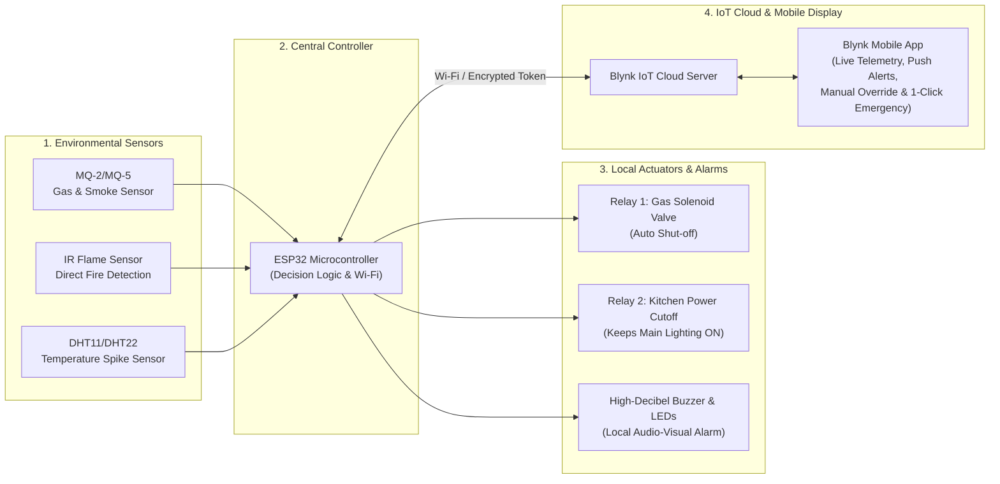

<div align="center">
  
</div>

# 🏠 Safety Home System | Software Engineering & Architecture Documentation

[](#)
[](#)
[](#)
[](#)
[-orange)](#)

> **EN:** **Safety Home** is a safety-critical IoT and Embedded Software System designed for homes and facilities to provide early detection and automated fail-safe response against combustible gas leaks, smoke, sudden temperature spikes, and direct flames.  
> **AR:** **Safety Home** هو نظام ذكي وحرج للسلامة (Safety-Critical System) يعتمد على إنترنت الأشياء (IoT) والأنظمة المدمجة لحماية المنازل والمنشآت عبر الكشف المبكر والاستجابة التلقائية الفورية ضد تسريبات الغاز، الدخان، الارتفاع المفاجئ في الحرارة، والحرائق المباشرة.

🎓 **Academic Supervision (الإشراف الأكاديمي):**
- **Course Instructor (أستاذ المادة):** **Dr. Ahmed Yousry (د. أحمد يسري)**
- **Teaching Assistant (المعيدة المشرفة):** **Eng. Sohaila Amr (م. سهيلة عمرو)**
- **Institution (الكلية):** Faculty of Computers and Artificial Intelligence — Benha University (BFCAI) • *Third Year (Artificial Intelligence Department)*

🔗 **Quick Project Links (روابط المشروع السريعة):**
- 🌐 **Live Product Landing Page (صفحة الويب التعريفية):** [Safety Home Web Portal](https://github.com/mooaz-ebrahiem/safety_home)
- 📸 **Official Instagram Page (صفحة إنستجرام الرسمية):** [@safety.home.eg](https://www.instagram.com/safety.home.eg/)
- 💻 **Documentation Repository (مستودع التوثيق الهندسي):** [Software-Engineering-Architecture-Documentation](https://github.com/Mohamed-Tamer-Ai/Software-Engineering-Architecture-Documentation)

---

## 📑 Table of Contents (فهرس المحتويات)
1. [Project Overview (نظرة عامة على المشروع)](#-1-project-overview-نظرة-عامة-على-المشروع)
2. [Key System Features (المميزات الرئيسية)](#-2-key-system-features-المميزات-الرئيسية)
3. [Hardware & Software Architecture (البنية المعمارية)](#-3-hardware--software-architecture-البنية-المعمارية)
4. [System Lifecycle & Emergency Workflow (سيناريو التشغيل)](#-4-system-lifecycle--emergency-workflow-سيناريو-التشغيل)
5. [Requirements Engineering (هندسة المتطلبات)](#-5-requirements-engineering-هندسة-المتطلبات)
6. [UML System Modeling & Scenarios (النمذجة الهندسية وفق سكاشن المادة)](#-6-uml-system-modeling--scenarios-النمذجة-الهندسية-وفق-سكاشن-المادة)
7. [Software Engineering Artifacts (هيكل المستودع)](#-7-software-engineering-artifacts-هيكل-المستودع)
8. [Course References & Section Drives (مصادر ودرايف سكاشن المادة)](#-8-course-references--section-drives-مصادر-ودرايف-سكاشن-المادة)
9. [Project Team — Team #5 (أعضاء الفريق)](#-9-project-team--team-5-أعضاء-الفريق)

---

## 📌 1. Project Overview (نظرة عامة على المشروع)

$$\text{Requirements Analysis} \rightarrow \text{Design} \rightarrow \text{Implementation} \rightarrow \text{Testing} \rightarrow \text{Maintenance}$$

| Aspect (الجانب) | English Specification | الشرح والتوصيف بالعربية |
| :--- | :--- | :--- |
| **🎯 Engineering Philosophy**<br/>*(الفلسفة الهندسية)* | When embedded software directly controls physical hardware in a **Smart Home**, any defect can impact human safety, cost, and trust. Therefore, **Safety Home** is engineered using a **systematic, disciplined, and quantifiable** Software Engineering approach across all stages of the **SDLC**. | عندما يتحكم السوفتوير المدمج مباشرة في الهاردوير داخل المنازل الذكية، فإن أي خطأ قد يؤثر على سلامة الأرواح والتكلفة والثقة؛ لذلك تم بناء وتوثيق نظام **Safety Home** باتباع منهجية هندسة برمجيات منظمة ومنضبطة وقابلة للقياس خلال جميع مراحل دورة حياة النظام. |
| **⚙️ Core Operation**<br/>*(آلية العمل الأساسية)* | **Safety Home** continuously monitors indoor environmental conditions in real time. Upon detecting a hazard (gas leak, smoke, rapid thermal spike, or flame), it executes an immediate local fail-safe protocol—cutting off the gas valve and isolating kitchen outlets while **keeping primary room lighting active** for safe evacuation—and alerts the homeowner via the **Blynk IoT App** with one-click emergency calling. | يراقب النظام بيئة المنزل لحظياً؛ وعند رصد أي خطر (تسريب غاز، دخان، ارتفاع مفاجئ بالحرارة، أو لهب)، ينفذ النظام بروتوكول أمان محلي فوري يشمل إغلاق محبس الغاز وفصل كهرباء المطبخ لمنع الشرر مع **الإبقاء على الإضاءة الأساسية شغالة** للإخلاء الآمن، وإرسال إشعار فوري لتطبيق **Blynk** مع زر اتصال سريع بالطوارئ. |

---

## ✨ 2. Key System Features (المميزات الرئيسية)

| Feature Category (الفئة) | Feature & Sub-System | English Description | الوصف الهندسي بالعربية |
| :---: | :--- | :--- | :--- |
| **🔥 Multi-Hazard Detection**<br/>*(الرصد المبكر المتعدد)* | **Gas & Smoke Monitoring** | Continuous sensing of LPG, methane, natural gas, and smoke using `MQ-2 / MQ-5` sensors. | قياس مستمر لنسب الغازات القابلة للاشتعال (البوتاجاز، الميثان، الغاز الطبيعي) والدخان الناتج عن بداية الحرائق. |
| **🔥 Multi-Hazard Detection**<br/>*(الرصد المبكر المتعدد)* | **Direct Flame Detection** | Instant optical detection of fire outbreaks via an `IR Flame Sensor`. | استشعار بصري لحظي لألسنة اللهب والنيران المباشرة بمجرد ظهورها. |
| **🔥 Multi-Hazard Detection**<br/>*(الرصد المبكر المتعدد)* | **Thermal Spike Detection** | Monitoring rapid, abnormal increases in ambient temperature (via `DHT11 / DHT22`) before fire spreads. | رصد أي ارتفاع سريع وغير طبيعي في درجة حرارة الغرفة لإطلاق إنذار مبكر حتى قبل انتشار النيران. |
| **⚡ Smart Power & Gas Control**<br/>*(الفصل الذكي والآمن)* | **Kitchen Spark Isolation** | Automatically disconnects kitchen appliances and power sockets via relays during a gas leak to eliminate sparks. | فصل فيش وأجهزة المطبخ الكهربائية تلقائياً عند رصد تسريب غاز لمنع حدوث أي شرارة كهربائية (Spark). |
| **⚡ Smart Power & Gas Control**<br/>*(الفصل الذكي والآمن)* | **Evacuation Lighting Exception** | Intentionally keeps the main room lighting circuit powered so residents can see and evacuate safely. | **استثناء الإضاءة:** يترك النظام خط الإضاءة الأساسي يعمل لتوفير الرؤية اللازمة للأفراد للتحرك والخروج بأمان. |
| **⚡ Smart Power & Gas Control**<br/>*(الفصل الذكي والآمن)* | **Automated Gas Shut-Off** | Automatically closes the mechanical gas solenoid valve via relay control. | إغلاق محبس الغاز الميكانيكي الآلي فوراً لمنع تفاقم التسريب أو الاشتعال. |
| **🔊 Local Alerting**<br/>*(الإنذار المحلي المزدوج)* | **Audio-Visual Warning** | Activates a high-decibel **Buzzer** and visual **LED** indicators immediately on-site. | إطلاق صافرة إنذار قوية (Buzzer) وإضاءة مؤشرات (LED) لتنبيه المتواجدين داخل المنزل فوراً. |
| **📱 IoT & Emergency App**<br/>*(تطبيق الموبايل والطوارئ)* | **Live Telemetry & Push Alerts** | Real-time sensor monitoring on the user's smartphone via **Blynk IoT** with instant Push Notifications. | متابعة قراءات الحساسات "لايف" عبر تطبيق الموبايل مع إرسال إشعارات تحذيرية عاجلة عند تخطي حد الأمان. |
| **📱 IoT & Emergency App**<br/>*(تطبيق الموبايل والطوارئ)* | **Remote Manual Override** | Remote control switch to manually shut off valves or reset the system after hazard clearance. | زر تحكم يدوي عن بُعد لفتح أو غلق المحبس وإعادة ضبط النظام بعد التأكد من زوال الخطر. |
| **📱 IoT & Emergency App**<br/>*(تطبيق الموبايل والطوارئ)* | **One-Click Emergency Call** | Direct in-app shortcut to call Civil Defense (Fire Department / Ambulance) with a single tap. | خيار مخصص داخل التطبيق يتيح الاتصال المباشر بالمطافي أو الإسعاف أو الطوارئ بضغطة واحدة. |

---

## 🏗️ 3. Hardware & Software Architecture (البنية المعمارية)

Following the standard **Safety-Critical Embedded Architecture** ($\text{Sensor} \rightarrow \text{Controller} \rightarrow \text{Actuator / Alarm / Display}$):



### 🔧 3.1 Hardware Components (المكونات الهاردوير)

| # | Component (المكون) | Technical Specification (EN) | الوظيفة والتوصيف الهندسي (AR) |
| :-: | :--- | :--- | :--- |
| **1** | **Microcontroller (`ESP32`)** | Central processing board with built-in Wi-Fi & Bluetooth for sensor acquisition, local decision-making, and cloud communication. | لوحة المعالجة المركزية المزودة بـ Wi-Fi و Bluetooth لتجميع قراءات الحساسات، اتخاذ قرار الفصل اللحظي، والاتصال بالسحابة. |
| **2** | **Gas & Smoke Sensor (`MQ-2 / MQ-5`)** | Electrochemical sensor for detecting LPG, methane, natural gas, and smoke concentration. | حساس غاز ودخان للكشف المبكر عن تسريبات غاز البوتاجاز، الغاز الطبيعي، الميثان، والدخان. |
| **3** | **Flame Sensor (`IR Flame`)** | Infrared optical sensor for instant detection of direct fire and flame wavelengths. | حساس لهب بالأشعة تحت الحمراء لاستشعار بدايات النيران واللهب المباشر لحظياً. |
| **4** | **Temperature Sensor (`DHT11 / DHT22`)** | Digital temperature sensor for monitoring ambient thermal spikes before fire spreads. | حساس حرارة رقمي لرصد درجة حرارة المكان واكتشاف أي ارتفاع مفاجئ وغير طبيعي. |
| **5** | **Relay Module 1 (`Gas Valve Relay`)** | Electromechanical switch controlling the automated gas solenoid valve. | وحدة فصل وتوصيل (Relay) للتحكم في إغلاق صمام/محبس الغاز الآلي فور رصد الخطر. |
| **6** | **Relay Module 2 (`Smart Power Relay`)** | Isolates kitchen power sockets to prevent sparks while preserving the primary room lighting circuit. | وحدة فصل ذكية تقطع التغذية الكهربائية عن أجهزة وفيش المطبخ منعاً للشرر، مع الإبقاء على خط الإضاءة الأساسي شغالاً. |
| **7** | **Local Alarm (`Buzzer & LEDs`)** | High-decibel piezoelectric buzzer and status LEDs for immediate on-site audio-visual warning. | صافرة إنذار صوتية عالية ومؤشرات إضاءة ليد للتنبيه السمعي والبصري الفوري داخل المكان. |
| **8** | **Power Supply** | Regulated fail-safe power supply unit to operate the controller, sensors, and relays safely. | مصدر طاقة منظم وآمن لتشغيل لوحة التحكم والحساسات والـ Relays باستقرار تام. |

### 💻 3.2 Software & Modeling Stack (البرمجيات والمنصات)

| Layer (الطبقة) | Technology / Tool | English Description | الشرح والتوصيف بالعربية |
| :--- | :--- | :--- | :--- |
| **Embedded Firmware** | `C++ (Arduino IDE)` | Firmware programmed on the `ESP32` to poll sensors, evaluate thresholds, and trigger relays. | الكود البرمجي المدمج على لوحة `ESP32` لقراءة الحساسات، مقارنة القراءات بحد الأمان، وتشغيل وحدات الفصل والإنذار. |
| **IoT Cloud & Mobile UI** | `Blynk Cloud & App` | Cloud server and mobile interface for live telemetry, push alerts, manual override, and emergency calls. | منصة وسحابة إنترنت الأشياء لعرض القراءات الحية على الهاتف، إرسال الإشعارات، التحكم اليدوي، والاتصال السريع بالطوارئ. |
| **Web Presence** | `HTML / CSS / JS (GitHub Pages)` | Product landing page hosted at `mooaz-ebrahiem/safety_home` showcasing system features and workflow. | موقع تعريفي وتسويقي للمشروع مرفوع على GitHub Pages لعرض فكرة المنتج ومميزاته وطريقة عمله للمستخدمين. |
| **UML & Design Tools** | `Draw.io` & `EdrawMax UML` | Standardized visual modeling tools used to construct structural and behavioral UML 2.5 diagrams. | الأدوات الهندسية المعتمدة في السكاشن لبناء مخططات لغة النمذجة الموحدة (UML) الهيكلية والسلوكية. |

---

## 🔄 4. System Lifecycle & Emergency Workflow (سيناريو التشغيل)

| Phase (المرحلة) | System State (حالة النظام) | English Workflow Description | سيناريو عمل النظام بالعربية |
| :-: | :--- | :--- | :--- |
| **1** | **🟢 Normal State**<br/>*(حالة الاستعداد)* | The system monitors all sensors continuously in the background and streams normal live telemetry to the Blynk mobile dashboard. | يعمل النظام بهدوء واستمرار في مراقبة الأجواء، وتظهر قراءات الحساسات الطبيعية لحظياً على تطبيق Blynk. |
| **2** | **🟡 Detection State**<br/>*(حالة رصد الخطر)* | A sensor detects gas concentration, smoke, direct flame, or a sudden temperature spike exceeding safe thresholds and signals the `ESP32`. | يكتشف أحد الحساسات تسريب غاز، دخان، لهب مباشر، أو ارتفاع مفاجئ في الحرارة يتجاوز الحد الآمن، فيرسل إشارة فورية لمعالج `ESP32`. |
| **3** | **🔴 Automated Action State**<br/>*(الاستجابة الفورية الآلية)* | • Triggers the local `Buzzer` and warning `LEDs`.<br/>• Cuts off kitchen power outlets via `Relay 2` while **keeping primary lighting ON**.<br/>• Closes the main gas valve automatically via `Relay 1`.<br/>• Dispatches an urgent Push Notification via Wi-Fi to the `Blynk App`. | • يطلق الـ `Buzzer` صوت إنذار قوي وتضيء لمبات التحذير.<br/>• يفصل `Relay 2` فيش وأجهزة المطبخ فوراً منعاً لأي شرارة مع **الإبقاء على الإضاءة شغالة**.<br/>• يغلق `Relay 1` محبس الغاز الآلي تلقائياً.<br/>• يرسل `ESP32` إشعار طوارئ عاجل للهاتف عبر الـ Wi-Fi. |
| **4** | **🔵 Resolution & Escalation**<br/>*(التحكم والحل وطلب الطوارئ)* | The homeowner reviews live readings on the mobile app, can press the **One-Click Emergency Call** button to contact the Fire Department/Ambulance, or perform a **Manual Override** once the hazard is resolved. | يتابع المستخدم الوضع من التطبيق، ويمكنه الضغط على **زر الاتصال المباشر بالمطافي/الطوارئ** إذا استدعى الأمر، أو إعادة ضبط النظام يدوياً بعد زوال الخطر. |

---

## 📋 5. Requirements Engineering (هندسة المتطلبات)

### 5.1 Functional Requirements (المتطلبات الوظيفية)
*Functional Requirements (FRs) specify **what** the system must do:*

| ID | Requirement | Functional Specification (EN) | الوصف الوظيفي بالعربية |
| :---: | :--- | :--- | :--- |
| **FR-01** | **📡 Multi-Sensor Polling**<br/>*(قراءة الحساسات المستمرة)* | The `ESP32` shall continuously sample gas/smoke concentration (`MQ`), flame presence (`IR`), and ambient temperature (`DHT`). | يقوم المعالج `ESP32` بقراءة بيانات حساسات الغاز والدخان واللهب والحرارة بشكل لحظي ومستمر. |
| **FR-02** | **⚖️ Threshold Evaluation**<br/>*(تقييم عتبة الخطر)* | The system shall classify an emergency state immediately when any sensor reading exceeds predefined safety thresholds. | يقوم النظام بتصنيف الحالة كـ "حالة طوارئ" فوراً عند تجاوز قراءة أي حساس للحد الآمن المحدد مسبقاً. |
| **FR-03** | **🔌 Automated Fail-Safe Isolation**<br/>*(العزل والفصل الآلي الآمن)* | Upon hazard detection, the system shall trigger `Relay 1` to close the gas valve and `Relay 2` to cut kitchen appliance power while keeping primary lighting active. | عند رصد خطر، يقوم النظام بتشغيل `Relay 1` لإغلاق محبس الغاز و`Relay 2` لفصل كهرباء المطبخ مع الحفاظ على إضاءة الغرفة الأساسية. |
| **FR-04** | **🔊 Local Audio-Visual Alarm**<br/>*(تفعيل الإنذار المحلي)* | The system shall activate the on-site buzzer and warning LEDs immediately upon hazard detection. | يقوم النظام بتشغيل صافرة الإنذار المحلية (`Buzzer`) ومؤشرات الـ `LED` فور اكتشاف أي خطر. |
| **FR-05** | **📲 Cloud Telemetry & Push Alerts**<br/>*(المزامنة السحابية والإشعارات)* | The system shall transmit live sensor data and instant emergency push notifications to the homeowner's Blynk mobile application. | يرسل النظام القراءات الحية وإشعارات الطوارئ العاجلة (`Push Notifications`) إلى تطبيق Blynk على هاتف المستخدم. |
| **FR-06** | **🆘 Manual Override & Emergency Call**<br/>*(التحكم اليدوي والاتصال بالطوارئ)* | The mobile application shall allow authenticated users to remotely shut off/reset relays (when readings are safe) and initiate a one-click call to emergency services. | يتيح التطبيق للمستخدم التحكم اليدوي عن بُعد في المحابس (بشرط زوال الخطر) والاتصال المباشر بالمطافي أو الإسعاف بضغطة واحدة. |

### 5.2 Non-Functional Requirements (المتطلبات غير الوظيفية)
*Non-Functional Requirements (NFRs) specify **how well** the safety-critical system performs its functions:*

| ID | Requirement | Quantifiable Engineering Specification (EN) | الوصف الهندسي بالعربية |
| :---: | :--- | :--- | :--- |
| **NFR-01** | **🛡️ Reliability**<br/>*(الاعتمادية)* | The system shall operate continuously ($24/7$) without unexpected crashes during normal use and detect hazards accurately with minimal false alarms. | يعمل النظام باستمرار على مدار الساعة ($24/7$) ويرصد المخاطر بدقة واعتمادية عالية دون توقف مفاجئ أو إنذارات كاذبة. |
| **NFR-02** | **⚡ Performance**<br/>*(الأداء وسرعة الاستجابة)* | The system shall execute local hardware actions (buzzer & relay cutoffs) within $< 1\text{ second}$ of detection and deliver mobile push notifications within $< 3\text{ seconds}$. | الاستجابة اللحظية للخطر محلياً (تشغيل الإنذار وفصل المحابس) في أقل من ثانية واحدة، وإرسال إشعار الهاتف في أقل من $3$ ثوانٍ. |
| **NFR-03** | **🔒 Security**<br/>*(الأمان السيبراني)* | Remote access and manual override controls via Blynk shall be protected using authenticated credentials and encrypted tokens against unauthorized users. | حماية الوصول عن بُعد والتحكم في المحابس ضد أي دخول غير مصرح به عبر جلسات موثقة ومشفرة. |
| **NFR-04** | **📱 Usability**<br/>*(سهولة الاستخدام)* | The mobile application dashboard shall be simple and intuitive, allowing homeowners to view hazard status or trigger an emergency call in $\le 2\text{ taps}$. | واجهة تطبيق الموبايل بسيطة وسهلة الاستخدام تتيح قراءة الحساسات أو طلب الطوارئ بضغطة أو ضغطتين كحد أقصى. |
| **NFR-05** | **🌐 Availability**<br/>*(الإتاحة والعمل بدون إنترنت)* | The local safety loop (sensors, ESP32, buzzer, and relays) shall remain $100\%$ operational offline even if Wi-Fi or internet connectivity is lost. | عمل الإنذار المحلي وفصل الغاز والكهرباء تلقائياً بكفاءة تامة ($100\%$) حتى في حال انقطاع اتصال الـ Wi-Fi أو الإنترنت. |
| **NFR-06** | **🚨 Safety**<br/>*(السلامة والأمان المادي)* | The system shall prevent unsafe operations during emergencies (cutting kitchen sparks while keeping evacuation lighting ON, and blocking valve re-opening until gas clears). | منع أي تشغيل غير آمن وقت الطوارئ (فصل كهرباء المطبخ مع إبقاء الإضاءة للإخلاء، ومنع إعادة فتح المحبس طالما الخطر قائماً). |
| **NFR-07** | **🔧 Maintainability**<br/>*(قابلية الصيانة)* | Sensors (`MQ`, `Flame`, `DHT`) and modular firmware functions shall be designed for easy inspection, calibration, fault isolation, and hardware replacement. | سهولة فحص وصيانة ومعايرة واستبدال الحساسات ومكونات الهاردوير والكود البرمجي المعياري. |
| **NFR-08** | **📈 Scalability**<br/>*(قابلية التوسع)* | The system architecture shall support integrating additional IoT sensor nodes, extra rooms, or smart actuators in the future without major redesign. | قابلية النظام للتوسع مستقبلاً وإضافة حساسات جديدة أو تغطية غرف إضافية ومميزات أمان أخرى بسهولة. |

---

## 🧩 6. UML System Modeling & Scenarios (النمذجة الهندسية وفق سكاشن المادة)

In full alignment with the **Software Engineering Course Sections**, the system is modeled across both **Behavioral** and **Structural** UML diagram families:

### 6.1 Course Sections Mapping (تطبيق محتوى السكاشن على المشروع)

| Section (السكشن) | UML Diagram / Topic | Engineering Scope in Safety Home (EN) | التطبيق الهندسي في المشروع بالعربية |
| :---: | :--- | :--- | :--- |
| **Section 1** | **SDLC & Safety-Critical Architecture**<br/>*(دورة حياة النظام والبنية المعمارية)* | Full lifecycle documentation ($\text{Requirements} \rightarrow \text{Design} \rightarrow \text{Implementation} \rightarrow \text{Testing} \rightarrow \text{Maintenance}$) and Hardware-Software control loop mapping ($\text{Sensor} \rightarrow \text{Controller} \rightarrow \text{Actuator}$). | توثيق مراحل تطوير النظام الخمس بالكامل، وتصميم حلقة التحكم المعمارية للأنظمة المدمجة الحرجة للسلامة (الحساسات $\leftarrow$ المعالج $\leftarrow$ المشغلات والإنذار). |
| **Section 2** | **UML Use Case Diagram & Tables**<br/>*(مخطط وجداول حالات الاستخدام - سلوكي)* | • **Primary Actors:** `Homeowner`, `Environmental Sensors`.<br/>• **Secondary Actors:** `Safety Actuators`, `Blynk Cloud`, `Emergency Services`.<br/>• **Relationships:** `Association`, `«include»`, `«extend»`, and `Generalization` + Structured Use Case Tables. | تحديد حدود النظام والأطراف الفاعلة الأساسية والمساعدة، ورسم العلاقات الأربع القياسية (`Association`, `«include»`, `«extend»`, `Generalization`) مع كتابة جداول توصيف السيناريوهات. |
| **Section 3** | **UML Activity Diagram**<br/>*(مخطط الأنشطة وتدفق العمليات - سلوكي)* | Multi-swimlane workflow (`Sensors` \| `ESP32` \| `Relays & Buzzer` \| `Blynk App`) showing continuous polling, threshold decision nodes, and `Fork/Join` parallel actions. | رسم مخطط تدفق العمليات مقسماً إلى مسارات (`Swimlanes`) يوضح المراقبة المستمرة، نقاط اتخاذ القرار عند الخطر، والعمليات المتوازية (`Fork/Join`) لفصل الغاز والكهرباء وإرسال التنبيهات. |
| **Section 4** | **UML Class Diagram**<br/>*(مخطط الفئات الهيكلي - هيكلي)* | Static OOP blueprint defining classes, attributes, methods, visibility (`+`, `-`, `#`), inheritance (`Sensor` hierarchy), and composition with `ESP32Controller` and `RelayActuator`. | تصميم الهيكل الثابت للنظام وتحديد الفئات (`Classes`) والخصائص والدوال وعلاقات التوريث (بين فئة الحساس الأب والحساسات الفرعية) والتركيب مع لوحة التحكم والـ Relays. |
| **Section 5** | **UML Sequence Diagram**<br/>*(مخطط التتابع الزمني - سلوكي)* | Time-ordered lifelines illustrating real-time emergency message passing with combined fragments (`loop` for polling, `alt` for hazard vs. normal, `opt` for emergency call). | رسم التفاعل الزمني اللحظي للرسائل بين مكونات النظام وقت الطوارئ باستخدام الأطر المركبة (`loop` للمراقبة، `alt` عند تخطي حد الخطر، و`opt` للاتصال بالطوارئ). |

---

### 6.2 Core Use Case Description Tables (جداول توصيف حالات الاستخدام)

#### 🚨 UC-01: Execute Emergency Protocol (تنفيذ بروتوكول الطوارئ التلقائي)
| Field (الحقل) | English Specification | التوصيف والشرح بالعربية |
| :--- | :--- | :--- |
| **Use Case ID & Name** | **UC-01: Execute Emergency Protocol** | **UC-01: تنفيذ بروتوكول الطوارئ التلقائي** |
| **Actor** | **Primary:** Environmental Sensors (`MQ`, `Flame`, `DHT`)<br/>**Supporting:** Safety Actuators (`Relays`, `Buzzer`), `Blynk Cloud` | **الفاعل الأساسي:** حساسات البيئة (الغاز، اللهب، الحرارة)<br/>**الفاعل المساعد:** مشغلات الأمان (`Relays` والإنذار)، سحابة `Blynk` |
| **Precondition** | The system is powered on in Normal State, and sensors are actively polling environmental data. | النظام يعمل في حالة الاستعداد الطبيعية، والحساسات متصلة بالـ `ESP32` وتقرأ البيانات بشكل لحظي. |
| **Main Success Scenario** | 1. A sensor detects gas, smoke, flame, or a rapid temperature spike exceeding the safe threshold.<br/>2. The sensor transmits a hazard signal to the `ESP32` controller.<br/>3. The system activates the local `Buzzer` and warning `LEDs`.<br/>4. The system triggers `Relay 2` to cut off kitchen electrical sockets while keeping primary room lighting ON.<br/>5. The system triggers `Relay 1` to close the mechanical gas solenoid valve.<br/>6. The system sends an urgent Push Notification to the homeowner via `Blynk Cloud`. | 1. يرصد أحد الحساسات تسريب غاز أو دخان أو لهب أو ارتفاع مفاجئ في الحرارة يتجاوز الحد الآمن.<br/>2. يرسل الحساس إشارة الخطر إلى وحدة المعالجة `ESP32`.<br/>3. يقوم النظام بتفعيل صافرة الإنذار المحلية (`Buzzer`) وإضاءة الـ `LED` التحذيري.<br/>4. يرسل النظام أمراً لـ `Relay 2` لفصل فيش وأجهزة المطبخ فوراً مع الإبقاء على الإضاءة الأساسية شغالة.<br/>5. يرسل النظام أمراً لـ `Relay 1` لإغلاق محبس الغاز الآلي.<br/>6. يرسل النظام إشعاراً تحذيرياً عاجلاً إلى هاتف المستخدم عبر سحابة `Blynk`. |
| **Alternative Flows** | **A. Wi-Fi / Internet Disconnected:** The system executes steps 3, 4, and 5 locally without delay (Offline Fail-Safe) and queues the cloud alert until connectivity is restored.<br/>**B. Valve Relay Fault:** The system keeps the alarm active and sends a critical alert instructing immediate manual evacuation. | **أ. انقطاع الـ Wi-Fi أو الإنترنت:** ينفذ النظام الخطوات 3 و 4 و 5 محلياً بالكامل بدون أي تأخير، ويحفظ التنبيه لإرساله فور عودة الاتصال.<br/>**ب. عطل في استجابة المحبس:** يستمر الإنذار المحلي ويرسل تنبيهاً حرجاً للمستخدم بضرورة الإخلاء والتدخل اليدوي. |
| **Postcondition** | Gas supply and kitchen spark sources are isolated, evacuation lighting remains active, local alarm is sounding, and the homeowner is notified. | مصادر الخطر (الغاز وكهرباء المطبخ) مفصولة تماماً، الإضاءة تعمل للإخلاء الآمن، الإنذار مفعل، وتم إخطار صاحب المنزل. |

#### 🎛️ UC-02: Manual Valve & Power Override (التحكم اليدوي عن بُعد)
| Field (الحقل) | English Specification | التوصيف والشرح بالعربية |
| :--- | :--- | :--- |
| **Use Case ID & Name** | **UC-02: Manual Valve & Power Override** | **UC-02: التحكم اليدوي في المحبس والتيار عن بُعد** |
| **Actor** | **Primary:** Homeowner (User)<br/>**Supporting:** `Blynk Cloud`, Safety Actuators (`Relays`) | **الفاعل الأساسي:** صاحب المنزل (المستخدم)<br/>**الفاعل المساعد:** سحابة `Blynk`، وحدات الفصل (`Relays`) |
| **Precondition** | The homeowner is authenticated in the Blynk mobile app and the `ESP32` is online. | المستخدم مسجل الدخول على تطبيق `Blynk`، ولوحة `ESP32` متصلة بالإنترنت. |
| **Main Success Scenario** | 1. The homeowner opens the Blynk dashboard.<br/>2. The homeowner toggles the Manual Override switch to shut off the gas valve or reset the system.<br/>3. The system verifies current sensor readings to ensure no active hazard exists (if re-opening).<br/>4. `Blynk Cloud` relays the command to the `ESP32`, which updates the relay state and confirms status on the app. | 1. يفتح المستخدم لوحة التحكم في تطبيق `Blynk`.<br/>2. يضغط المستخدم على زر التحكم اليدوي (`Manual Override`) لغلق محبس الغاز أو إعادة تشغيل النظام.<br/>3. يتحقق النظام من قراءات الحساسات الحالية للتأكد من زوال الخطر تماماً (في حال طلب إعادة الفتح).<br/>4. ترسل سحابة `Blynk` الأمر إلى `ESP32` لتحديث حالة الـ `Relay` وتأكيد الحالة على شاشة التطبيق. |
| **Alternative Flows** | **A. Hazard Still Present During Reset Attempt:** The system rejects the re-open command and displays a safety lock warning until gas/temperature levels return to normal. | **أ. محاولة إعادة الفتح مع استمرار وجود خطر:** يرفض النظام أمر إعادة الفتح ويعرض رسالة تحذير بأن نسبة الغاز أو الحرارة ما زالت مرتفعة. |
| **Postcondition** | The relay state is updated safely and recorded in the system logs. | يتم تحديث حالة المحبس أو التيار الكهربائي بأمان وتوثيق العملية في سجل النظام. |

#### 📞 UC-03: Call Emergency Services (طلب الطوارئ السريع بضغطة واحدة)
| Field (الحقل) | English Specification | التوصيف والشرح بالعربية |
| :--- | :--- | :--- |
| **Use Case ID & Name** | **UC-03: Call Emergency Services (One-Click Dispatch)** | **UC-03: الاتصال الفوري بخدمات الطوارئ (المطافي / الإسعاف)** |
| **Actor** | **Primary:** Homeowner (User)<br/>**Supporting:** Emergency Services (Fire Department / Ambulance) | **الفاعل الأساسي:** صاحب المنزل (المستخدم)<br/>**الفاعل المساعد:** خدمات الطوارئ (المطافي / الإسعاف) |
| **Precondition** | The homeowner has received a hazard push notification and opened the Blynk app. | وصول إشعار خطر للمستخدم عبر تطبيق `Blynk` وفتح التطبيق لمراجعة الموقف. |
| **Main Success Scenario** | 1. The homeowner reviews live sensor telemetry confirming a severe fire or gas leak.<br/>2. The homeowner taps the dedicated **Emergency Call** button inside the app.<br/>3. The mobile application initiates a direct phone call to Civil Defense / Fire Department. | 1. يستعرض المستخدم قراءات الحساسات الحية التي تؤكد وجود حريق أو تسريب كثيف.<br/>2. يضغط المستخدم على زر **الاتصال بالطوارئ** المخصص داخل واجهة التطبيق.<br/>3. يقوم التطبيق بتحويل المستخدم مباشرة لإجراء مكالمة فورية مع رقم المطافي أو الإسعاف. |
| **Alternative Flows** | **A. User Cancels Dialing:** The application returns to the live monitoring dashboard. | **أ. إلغاء الاتصال من قبل المستخدم:** يعود التطبيق إلى شاشة المراقبة الحية الرئيسية. |
| **Postcondition** | Direct communication with emergency responders is established. | بدء مكالمة الطوارئ المباشرة مع الجهات المختصة للتعامل السريع مع الحادث. |

---

## 📐 7. Software Engineering Artifacts (هيكل المستودع)

This repository is organized according to the **SDLC stages** and **UML course sections**:

```text
├── 01-Requirements/
│   ├── SRS_Document.pdf                 # Functional & Non-Functional Requirements (Section 1)
│   └── Risk_Analysis.md                 # Safety-critical hazard & mitigation matrix
├── 02-System-Design-UML/
│   ├── 1_Hardware_Software_Architecture.png
│   ├── 2_Use_Case_Diagram.png           # Actors, Boundary, Include/Extend/Generalization (Section 2)
│   ├── 3_Use_Case_Descriptions.md       # Structured scenario tables UC-01 to UC-05 (Section 2)
│   ├── 4_Activity_Diagram.png           # Multi-swimlane emergency workflow & Fork/Join (Section 3)
│   ├── 5_Class_Diagram.png              # Static OOP structure & relationships (Section 4)
│   ├── 6_Sequence_Diagram.png           # Time-ordered lifelines & alt/loop/opt fragments (Section 5)
│   └── 7_State_Machine_Diagram.png      # Normal -> Detection -> Action -> Resolved
├── 03-UI-and-Prototypes/
│   ├── Blynk_Mobile_UI_Screenshots/     # Mobile dashboard & emergency button views
│   └── Landing_Page_Preview.png         # Web interface preview
├── 04-Testing-and-QA/
│   └── Test_Cases_Report.md             # Input -> Run -> Observe -> Compare -> Fix (Section 1)
└── README.md
```

| Folder (المجلد) | Engineering Contents (EN) | محتويات المجلد بالعربية |
| :--- | :--- | :--- |
| 📁 `01-Requirements/` | Formal SRS document (Functional & Non-Functional Requirements) and safety-critical Risk Analysis matrix. | وثيقة متطلبات النظام الرسمية (`SRS`) شاملة المتطلبات الوظيفية وغير الوظيفية، ومصفوفة تحليل المخاطر. |
| 📁 `02-System-Design-UML/` | High-resolution architectural and UML 2.5 diagrams (`Use Case`, `Activity`, `Class`, `Sequence`, `State Machine`) + Scenario Tables. | رسومات البنية المعمارية ومخططات `UML` القياسية الخمسة المشروحة في السكاشن مع جداول توصيف السيناريوهات. |
| 📁 `03-UI-and-Prototypes/` | Screenshots of the Blynk IoT mobile interface, emergency call button, and web landing page previews. | لقطات شاشة لواجهة تطبيق الموبايل `Blynk`، زر الطوارئ، وتصميم صفحة الهبوط التسويقية للمشروع. |
| 📁 `04-Testing-and-QA/` | Structured test cases following the 5-step testing lifecycle ($\text{Input} \rightarrow \text{Run} \rightarrow \text{Observe} \rightarrow \text{Compare} \rightarrow \text{Fix}$). | تقرير حالات الاختبار (`Test Cases`) للحساسات والـ Relays والتطبيق وفق خطوات الاختبار الخمس في المحاضرة الأولى. |

---

## 📚 8. Course References & Section Drives (مصادر ودرايف سكاشن المادة)

All software engineering methodologies, SRS structures, and UML 2.5 diagrams in this project follow the official course lectures and lab sections taught at **BFCAI**:

| Reference / Resource (المصدر) | Link (الرابط) | Content Summary (EN) | ملخص المحتوى بالعربية |
| :--- | :--- | :--- | :--- |
| 📂 **Eng. Sohaila Amr — Sections Drive** | [Google Drive — Eng. Sohaila Amr](https://drive.google.com/drive/folders/1Cc5uqR_4g4JoxBAv0JILOPmbJsHCVlBW) | Covers Session 1 Intro to SE & SDLC, Section 2 UML Use Case Diagrams & Scenario Tables, Section 3 Activity Diagrams, Section 4 Class Diagrams, and Section 5 Sequence Diagrams. | يحتوي على شرح السكاشن من الأول للخامس: مقدمة هندسة البرمجيات ودورة حياة النظام، مخطط وجداول `Use Case`، ومخططات `Activity` و`Class` و`Sequence`. |
| 📂 **Eng. Roaa Ayman — Sections Drive** | [Google Drive — Eng. Roaa Ayman](https://drive.google.com/drive/folders/1G5Roq_Mc2sT9voUAzNUp9cH9soFu9CqV) | Covers Section 3 Activity Diagram, Section 4 Class Diagram, Section 5 Sequence Diagram, and Approved Modeling Tools. | يحتوي على ملفات شرح وتطبيقات السكشن الثالث والرابع والخامس وأدوات النمذجة الهندسية المعتمدة. |
| 🛠️ **Draw.io (diagrams.net)** | [Open Draw.io Online](https://app.diagrams.net/) | Free web-based UML 2.5 diagramming tool used for building system models. | أداة الرسم الهندسي المجانية عبر المتصفح لبناء مخططات `UML` الخاصة بالمشروع. |
| 🛠️ **Wondershare EdrawMax UML** | [EdrawMax UML Tool](https://edraw.wondershare.com/edraw-uml.html) | Desktop & online professional UML modeling software recommended in lab sections. | برنامج تصميم مخططات `UML` الاحترافي الموصى به في سكاشن المادة. |

---

## 👥 9. Project Team — Team #5 (أعضاء الفريق)

**Faculty of Computers and Artificial Intelligence — Benha University (BFCAI)**  
*Third Year • Artificial Intelligence Department (الفرقة الثالثة — قسم الذكاء الاصطناعي)*

| # | Team Member Name (الاسم بالكامل) | English Name | Section (السكشن) | Sec. BN (الرقم) |
| :-: | :--- | :--- | :-: | :-: |
| **1** | **محمد اكرم عبد المجيد محمد عبد الحميد** | Mohamed Akram Abd El-Mageed | سكشن 3 | رقم 5 |
| **2** | **محمد تامر محمد على الشيخ** | Mohamed Tamer Mohamed Elsheikh | سكشن 3 | رقم 6 |
| **3** | **محمد صبحى ابراهيم على عيد** | Mohamed Sobhy Ibrahim Ali | سكشن 3 | رقم 10 |
| **4** | **محمود محمد محمود محمد ابراهيم** | Mahmoud Mohamed Mahmoud | سكشن 3 | رقم 14 |
| **5** | **مريم محمد محمد لطفى صالح** | Mariam Mohamed Mohamed Lotfy | سكشن 3 | رقم 16 |
| **6** | **معاذ ابراهيم عطيه عبد السلام** | Mooaz Ebrahiem Attia | سكشن 3 | رقم 17 |
| **7** | **هبه الله محمد على فارس** | Heba Allah Mohamed Ali Fares | سكشن 4 | رقم 5 |

---

<div align="center">
  <b>Academic Supervision (تحت إشراف):</b><br/>
  👨‍🏫 <b>Dr. Ahmed Yousry (د. أحمد يسري)</b> &nbsp;|&nbsp; 👩‍💻 <b>Eng. Sohaila Amr (م. سهيلة عمرو)</b><br/>
  <i>Software Engineering Course — Faculty of Computers and Artificial Intelligence, Benha University (2026)</i>
</div>
